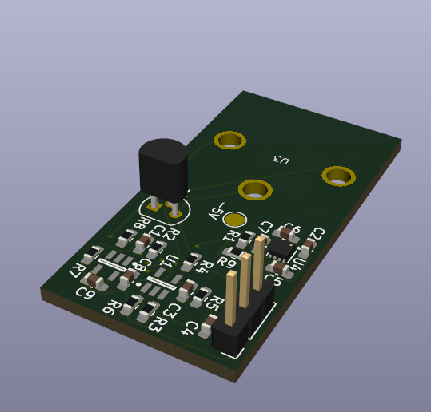
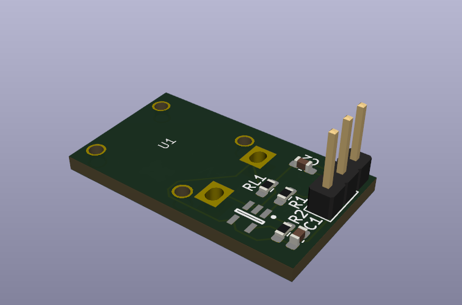
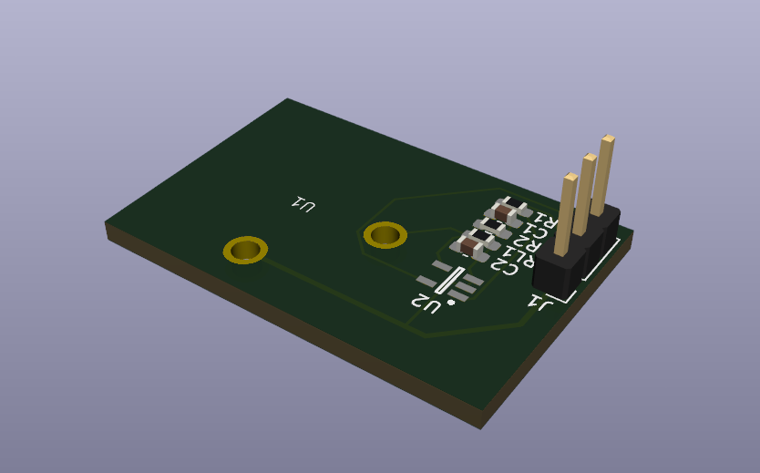
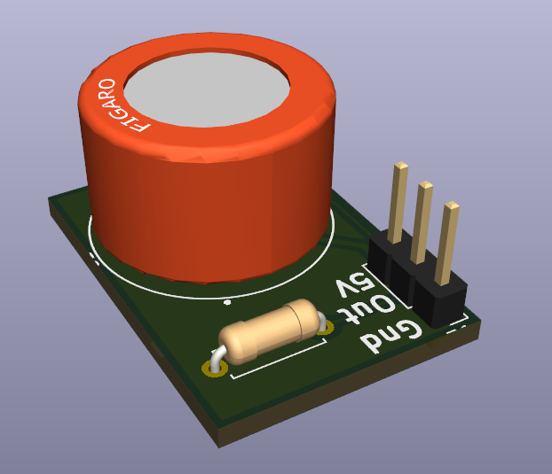
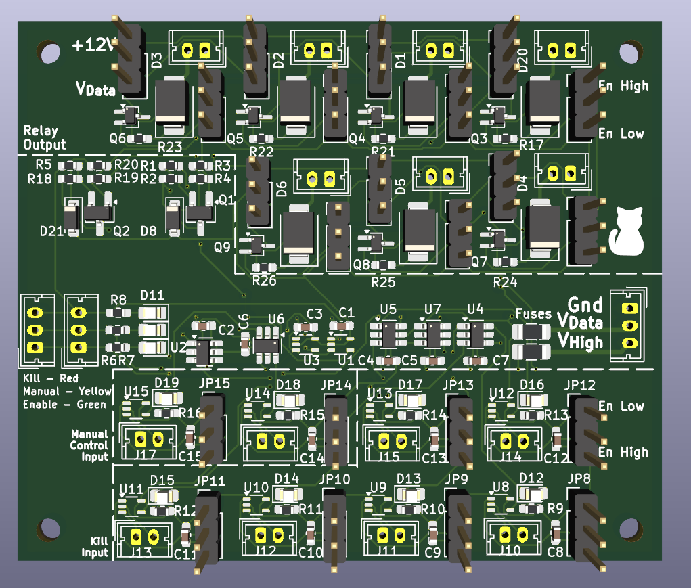
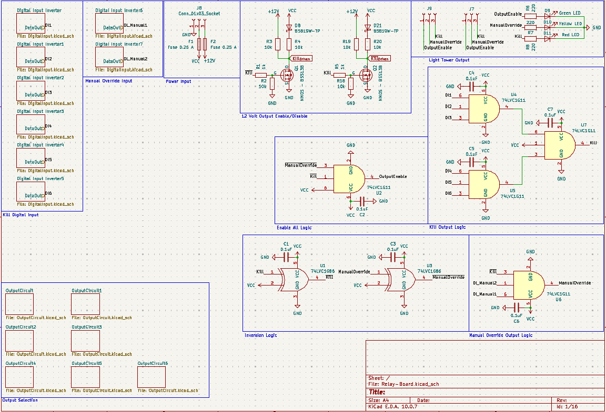
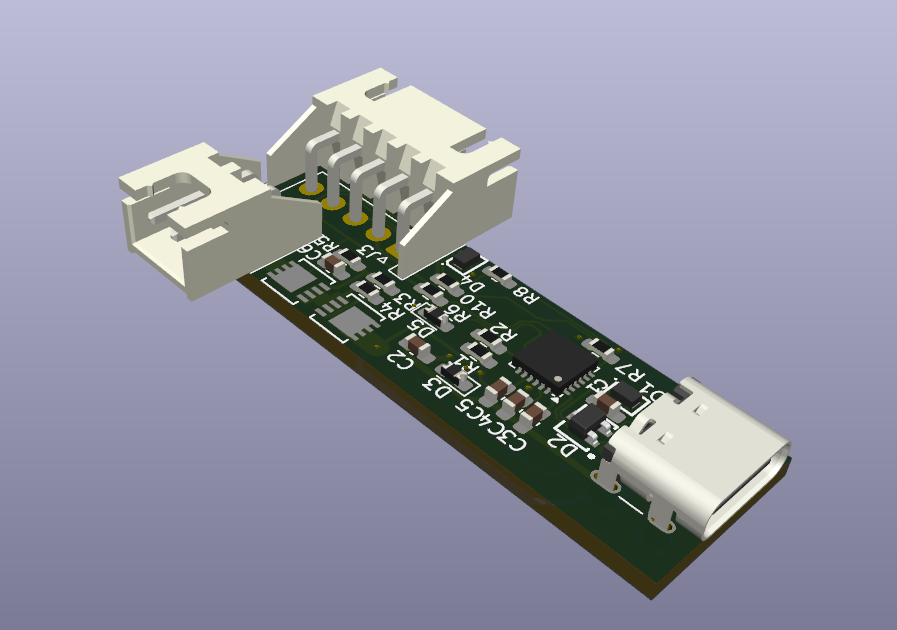
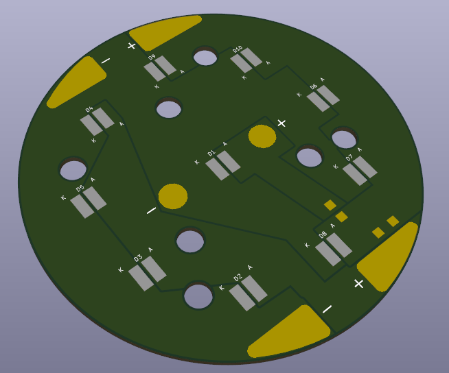
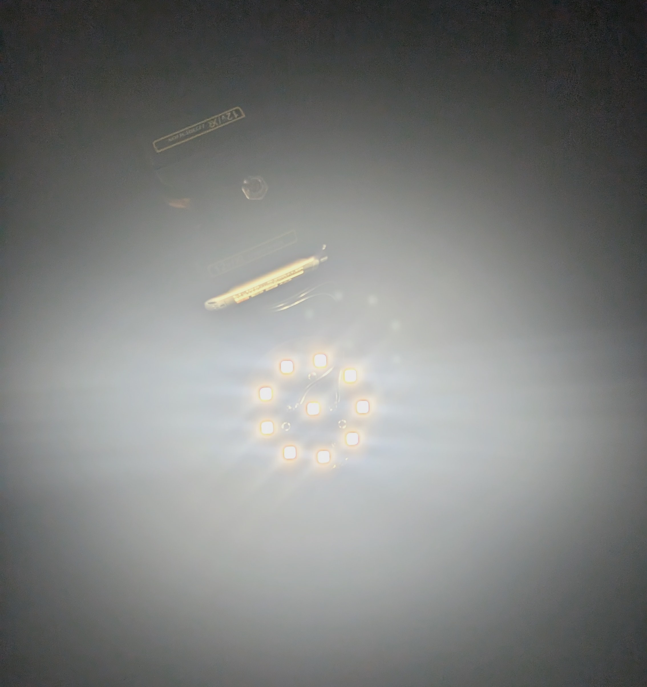

# PCB-Compilation

A collection of custom PCB designs, prototypes, and lab projects built for research and experimentation.

## [Air Quality Sensor Breakout Boards](https://github.com/uf-mil-electrical/misc_hardware/tree/7a44acb8b002e7d45b233cf23141b061ac4c3471/Sensing/Sensor_Breakouts)

I am building a set of sensor breakout boards that will eventually be combined into a single air quality sensing PCB. These boards are still in progress, and I am finishing the analog sensor boards before moving on to the digital ones.

These breakout boards were made for the Machine Intelligence Laboratory (MIL) and are part of a larger integrated sensing platform. View the breakout designs on [GitHub](https://github.com/uf-mil-electrical/misc_hardware/tree/7a44acb8b002e7d45b233cf23141b061ac4c3471/Sensing/Sensor_Breakouts).

## [Relay Control Board](https://github.com/uf-mil-electrical/NaviGator/tree/3adb6dfac39e3fa88b3697202d415e38e3245c48/Kill%20Board/2026/Relay-Board-PCB/Relay-Board)

A robust relay control and safety management board designed for hardware kill switching, power distribution, and status monitoring.

### Key Features:
* **Relay Outputs:** Features 7 relay outputs with selectable 12V and MCU-level voltage control options, protected by a dedicated 12V fuse.
* **Kill & Safety System:** 
  * 6 input signals with individual red status LEDs to monitor when a kill state is active.
  * 2 dedicated inputs for manual override (enables the yellow status indicator; overridden by the red kill state).
  * Active high/low configuration jumpers for flexible input/output logic.
  * Hardware override jumper to unkill the system.
* **Light Tower Status Indicators:** Built using 0803 SMD LEDs for clean labeling and visual feedback:
  * **Enable**
  * **Red:** Kill enabled
  * **Yellow:** Manual enable
  * **Green:** Autonomous / default operation

View the project source and design files on [GitHub](https://github.com/uf-mil-electrical/NaviGator/tree/3adb6dfac39e3fa88b3697202d415e38e3245c48/Kill%20Board/2026/Relay-Board-PCB/Relay-Board).

## [STUSB 4500 Controller](https://github.com/Justinorange/STUSB4500-Arduino-Controller)

The STUSB 4500 controller is one of the more complicated PCBs I have made, largely due to the use of USB C protocols and having to solder it by hand.

This board was made for FOCUS Lab last year and represents a more complex design in the collection. View the project source on [GitHub](https://github.com/Justinorange/STUSB4500-Arduino-Controller).

## [Flashlight Project](https://github.com/Justinorange/Flashlight)

This was a quick and fun project to build two flashlights that produce over 20,000 lumens each while keeping the cost as low as possible. The total cost for both was approximately $50. (I also just wanted to make a single sided aluminum PCB).

View the repository and design files on [GitHub](https://github.com/Justinorange/Flashlight).

## Project Summary

This repository highlights a diverse range of custom PCB projects, including modular air quality and hydrogen sensor systems, a comprehensive relay control board with hardware safety features, research-focused USB-C power controllers, and high-output lighting builds.
